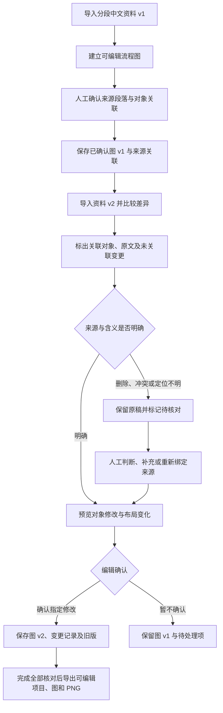

# 图解跟着资料改：首版设计与验证计划

日期：2026-11-06。状态：方向已确定，以下为待验证的设计与验收约束，尚未实现。依据[产品定位与范围](../产品定位与范围.md)及[二次调研](../差异化方向二次调研与验证建议-2026-11-05.md)。本次决策不代表真实案例、用户试用或效果门槛已通过。

## 一、一个用户任务

中文科普或培训编辑已经有一张确认过的机制流程图，之后收到新版资料。他需要知道哪些标签、注释或关系线要改，确认修改后交付 PNG，同时保留可编辑项目和旧版。

首轮只验证一个项目、一份分段中文资料的版本更替及一张图。首次制图可以从简单流程图开始，手工编辑对象并确认来源关联；图片生成、参考图和现有画布可辅助准备素材，不承担事实判定。原型无需等待生产后端完成，开发前必须先取得真实案例。

## 二、目标流程图

所有资料变更都进入核对清单，包括没有绑定到任何对象的新段落或变更。没有关联不等于不影响图解；编辑需确认其影响或补充关联，避免只检查已有链接而漏掉新事实。

## 三、首版页面与操作

工作区以一张图为中心，提供“资料”“图解”“修订清单”三个相互联动的区域。选中原文可查看关联对象，选中对象可返回来源；窄屏切换面板，保留当前选择。首页先解释并演示一次资料更正，再说明部署与保存方式，演示内容标明为示例。

| 阶段 | 用户看到什么 | 用户操作与结果 |
| --- | --- | --- |
| 首次导入 | 分段原文、资料版本、空白或已有可编辑流程图 | 建立或编辑节点、连线、标签与注释；确认每个事实对象的来源。装饰对象可明确标记为无事实来源。 |
| 查看差异 | 两版原文的增删改、关联对象高亮、未关联变化 | 逐项查看；明确的数值变化可给候选修改，定义或关系变化须人工核对含义。 |
| 审核修改 | 原文前后、对象前后、修改理由及可能的布局变化 | 确认指定修改或暂不确认；未经确认的提议不写入已确认版本。 |
| 处理异常 | 来源删除、冲突、无法定位或缺少关联的待核对项 | 保留原稿，重新绑定、手工修订或记录“无需改图”的理由，不能自动猜测替代结论。 |
| 交付与回看 | 已确认的新版本、变更清单、资料版本与旧图 | 导出可继续编辑的项目和图、发布版 PNG；查看或恢复旧版本。 |

示例：“预热 30 秒”改为“预热 45 秒”时，标签和脚注各列一条候选修改，并指向同一来源变更。未批准的其他步骤、配色、坐标和连线保持原样。若标签变长造成溢出，需展示排版候选及涉及的对象，由用户一并确认。

存在未处理项时可保存工作草稿，但不能将其标记为已完成核对的发布版本。确认来源删除后的处理不一定意味着删除图上对象，应由编辑根据新资料决定。

## 四、最小数据与修订约束

先用版本化 JSON 项目清单及现成 SVG 渲染验证；具体渲染库待真实案例确定。PNG 是发布结果，重新编辑和来源追溯依赖项目清单与可编辑对象，不能只保存位图。

| 记录 | 必须表达的信息 |
| --- | --- |
| 资料版本 | 文档 ID、版本 ID、段落 ID 和原文快照；段落移动、拆分或合并时不能只按行号认定为同一来源。 |
| 图上对象 | 稳定对象 ID、类型、内容、样式、位置和关系端点；标签、脚注及关系线均可独立定位。 |
| 来源关联 | 资料版本、段落 ID、对象 ID、引用内容与人工确认状态；允许一段对应多个对象，一个对象依赖多段资料。 |
| 修订提议 | 基准资料和图版本、受影响对象、旧值、候选新值、理由、待核对原因及确认状态。 |
| 已确认版本 | 完整项目快照、采用的来源关联、批准的对象变更、核对结果和导出版本；保留上一版。 |

修订只对当前审核的基准版本生效。如果预览期间图或资料又变了，必须重新比较，不能把过期提议直接覆盖到新版本。未批准对象的内容、样式、位置及关系应按稳定 ID 对比一致；自动排版产生的变化也必须进入预览和批准集合。

确定性文本差异可以辅助定位，不能保证语义影响判断完整。原文改写、关系变化、冲突及定位不明都进入人工核对；即便后续引入模型，也只生成候选提议。外部调用失败或保存失败时保留已确认旧版，显示失败并允许重试，不显示虚假的完成状态。

## 五、真实案例与对照记录

先找到以下三类实际发生过的改版记录，收齐两版原始资料、改前图和最终图，并在试验前标注应改、必须保留和需人工判断的对象。优先从现有知识内容制作寻找；当前尚未收集或核验这些材料。找不到时先继续积累案例，不以虚构样本替代需求证据。

| 案例 | 需要观察的内容 | 当前状态 |
| --- | --- | --- |
| 数值修正 | 单个事实影响多个标签或脚注；未关联变化也能进入核对 | 待收集 |
| 定义或关系变化 | 不止文字替换，可能影响节点、箭头或解释范围 | 待收集 |
| 来源删除或冲突 | 保留原稿、显示不确定性并支持人工处理 | 待收集 |

每例用相同资料、改前图、目标输出和验收清单比较当前手工流程与一个可运行的可编辑图解近邻（优先评估 Paper2Any）。PaperBanana-Interact 可运行时增加多轮生成对照。记录工具版本、配置、运行限制；未运行的竞品仅作公开能力对照。

每例分别记录首次导入和建链人工耗时、修订和核对人工耗时、交付导出人工耗时、总经过时间、模型调用及费用、关键事实漏改、误改、未批准对象变化。不得将建立来源关联的时间从总人工耗时中扣除；第二轮单次修订的收益单独报告。

继续门槛沿用调研建议：3 例至少 2 例的总人工耗时比最快可行基线下降 30%，全部案例无关键事实漏改、无未批准对象变动，两位非开发试用者各愿意拿下一份真实资料再试。若只在后续轮次节省时间，估算建链成本需要多少轮回收，再与实际修订频率比较。小样本达标仅允许继续验证，不能宣称市场成立。

## 六、实施与验收顺序

1. **样本阶段**：收集上述 3 例，冻结预期对象清单，跑通并计时手工及可运行近邻基线。此阶段不扩充通用工作台。
2. **单图原型**：样本具备后实现本地清单、单类流程图、人工来源绑定、资料比较、修订审核、版本恢复和导出；用真实案例完成闭环。
3. **效果判断**：核对对象、事实与人工耗时；完成两位非开发试用者试用，按门槛决定继续、缩减或停止。
4. **生产交付**：通过验证后，将已证明有用的资料、图解、关联、修订记录及媒体格式纳入[自部署迁移路线](../开源自部署目标与迁移路线.md)，完成生产运行、本地存储、迁移、备份恢复和许可审查。

原型的自动化检查应覆盖：一段关联多对象、定义和关系变化待核对、来源缺失或冲突、未关联新增事实、过期提议、未批准对象保持一致、版本恢复与导出后的项目重开。人工检查还须核对语义完整性、PNG 版式、文字溢出及来源定位体验。通过类型检查、构建或对象比较，不等于真实需求、创作质量或生产部署验收通过。
