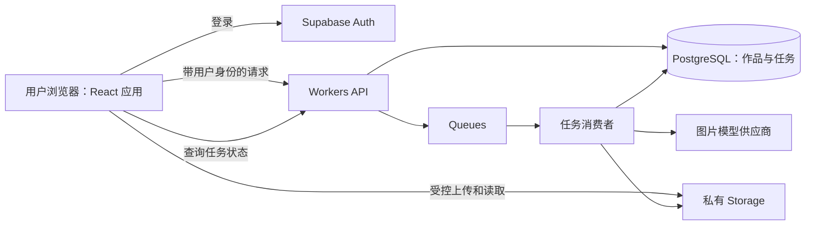

# 技术栈与架构方案

## 状态与决策边界

用户已确认按此推荐方案搭建架构；现有工程的实现状态见[开发与运行说明](开发与运行说明.md)。这不代表系统已部署或产品范围全部确定。优先地区、首批用户场景、云端保存方式、预算和模型供应商仍待确定。以下选择旨在支持面向海外的图片创作；视频、Agent、多人协作和复杂工作流暂不纳入首轮承诺。

此前[融合架构草案](融合架构草案.md)记录的浏览器直连约定已按用户确认调整：平台托管的模型凭据和生成任务由服务端处理。若未来选择用户自带密钥、仅本地保存的产品模式，应重新评估这一取舍。

## 建议选型

| 层次 | 推荐 | 原因与限制 |
| --- | --- | --- |
| 前端 | TypeScript、React、Vite、React Router | 图片工作区需要丰富的浏览器交互；与 infinite-canvas 参考版本的前端技术一致。公开营销页的搜索收录需求若成为重点，再单独评估预渲染或 SSR。 |
| UI 与状态 | Tailwind CSS、可访问的组件基础库、Zustand；服务端数据用 TanStack Query | 交互状态与远端数据分开；具体组件库在视觉设计及无障碍验证后选定，不同时默认引入多套大型 UI 框架。 |
| 画布 | React Flow（`@xyflow/react`）作为节点式画布首选候选 | 适合节点、连接、缩放和平移；并非完整的图片编辑器。先验证多图性能、触屏、键盘及画布交互，再决定采用或调整。 |
| 服务端 | TypeScript，Cloudflare Workers 提供 API，Queues 消费任务；同一代码库、按模块组织 | 托管密钥、鉴权、任务提交和状态恢复；队列和函数限制、成本、地区适配需在试点前确认。逻辑分层不等于一开始拆成多个独立微服务。 |
| 身份与数据 | Supabase Auth + PostgreSQL | 托管身份和关系数据；使用数据库行级安全策略（RLS）隔离用户。服务端特权访问同样必须显式鉴权。 |
| 文件 | Supabase 私有 Storage | 首期与账户、数据库同一平台，私有桶和单独的 Storage 策略保护原图与结果；比较地区、容量和流量成本后再开通。 |
| 模型 | 服务端供应商适配接口；首个图片供应商**待评测后确定** | 统一提交、查询、错误映射和能力声明；不同模型的输入、输出、可用性及定价不能假定相同。 |
| 部署与开发 | 前端静态资源部署至 Cloudflare；pnpm + Node.js LTS，锁文件固定依赖；Vitest + Playwright | 单仓库降低起步复杂度；运行环境及版本在搭建时按平台兼容性核验并锁定。 |

当前界面以中文优先；面向海外的英文体验后续评估，首期不预设多语言。移动端至少保证关键流程可用，复杂画布的触屏体验需单独验证。图片必须可下载，云保存是否默认开启取决于产品与预算决定。

## 方案比较与决策记录

### ADR 1：产品主体与部署形态

**选择：独立的 React 产品 + 模块化服务端 + 托管数据服务。** 模型和私有文件涉及凭据、访问控制、费用以及长任务恢复，服务器承担可信边界；前端主要负责交互。代价是多一个运行环境和托管服务，涉及费用、配置和供应商依赖。

备选一是纯浏览器 + 用户自带模型密钥 + 本地存储：原型快、运维少，但难以安全托管平台凭据、跨设备恢复或统一控制平台费用。备选二是直接继承某个上游或同时维护两套上游：起步可复用更多现成能力，但用户流程和技术结构被上游约束；Toonflow 使用 Vue，infinite-canvas 使用 React，直接合并界面成本高。两者均可作为功能参照，不作为本站整体架构。

### ADR 2：生成任务与数据

**选择：PostgreSQL 记录任务和提交意图，队列驱动后台处理，私有对象存储保存文件。** 任务状态以数据库为准，客户端轮询恢复；不让浏览器连接持续等待模型生成。与同步 API 相比，它增加任务编排、重复消息和恢复逻辑，但支持刷新页面后继续查询。服务端不能依赖单次 HTTP 请求长期运行。

备选为同步请求：实现更简单，但受超时和断线影响；任务处理很快且供应商支持可靠恢复时，可用于独立的轻量操作。备选为自建数据库、对象存储和队列：可控性更高，但现阶段运维负担大。托管平台不消除备份、权限审计、迁移和故障演练责任。

### ADR 3：画布与参考代码

**选择：React Flow 优先做最小节点画布验证，编辑能力按场景单独选型。** React Flow 适合节点界面，不自动提供蒙版、像素编辑或完整的资产管理；若验证发现自由绘制、蒙版编辑才是核心，需评估适合该需求的编辑器或独立编辑视图。不能仅凭静态源码判断上游生成质量或交互体验。

两个参考仓库当前记录的提交，其根目录许可证均为 MIT。实际复制代码时记录仓库、提交、文件和修改，保留所需版权及许可声明；素材、模型和第三方依赖可能另有条款，必须逐项核查。只读参考仓库、不在其中安装或修改。

## 架构与数据流



1. 用户登录，上传参考图至受权限约束的私有存储；服务端确认资源归属、类型和大小，创建带客户端幂等键的任务并检查配额。
2. 数据库在同一事务记录任务和待投递意图；投递器将任务 ID 发送到队列，并可安全重试。队列消息只是唤醒信号，数据库是状态来源。
3. 消费者原子领取任务，调用选定供应商。提交前后持久化尝试记录和供应商请求 ID；支持时传递供应商幂等键。收到结果后验证文件来源、大小与类型，写入私有存储并记录作品及最终状态。
4. 客户端轮询任务，刷新后从数据库恢复；需要访问文件时用受控的短期访问方式。失败时显示可理解的原因与可操作状态。

任务建议状态：`queued`、`submitting`、`running`、`succeeded`、`failed`、`unknown`。网络超时发生在供应商提交之后、请求 ID 保存之前时，不能假定未产生费用：若供应商支持幂等键或查询则先核对，否则标记 `unknown` 并人工或通过对账恢复，禁止盲目自动重新提交。回调仅在供应商验证机制明确时启用，须校验签名、重放和任务归属；初版可用定时查询代替。重复队列消息和重复回调不得重复结算或生成多个作品；投递、领取超时、供应商调用及文件写入各有独立恢复策略。费用上限须在提交前原子预留，最终按供应商实际结果对账；超时未知状态保留预留直至核实。

## 数据与安全边界

- 核心实体初步为用户、项目、素材、生成任务、生成结果，以及可选的画布文档；每条用户数据有明确所有者，二进制文件不存入业务 JSON。画布是否首期持久化由产品范围决定。
- 所有暴露给客户端的表启用并测试 RLS；Storage 的访问策略单独设置，私有桶默认拒绝跨用户访问。服务端特权密钥只能用于服务端，不能依赖 RLS 自动约束其操作。
- 校验身份、对象归属、上传大小与 MIME/实际文件类型；限制生成频率、并发与预算。供应商返回 URL 的下载要限制目标和重定向，防止访问内部网络，并限制文件大小与超时。
- 任务日志包含关联 ID、状态、延迟和脱敏错误，不记录密钥、完整提示词或图片内容；保留策略、导出与删除流程、备份恢复、隐私条款和目标地区数据要求在上线前确定。
- 数据库、存储和供应商均可能失败：保留失败原因、有限重试和告警；清理无引用文件需有可恢复的延迟窗口，并避免删除仍被其他作品引用的资源。

## 目录建议

```text
apps/web/             React 网站与创作界面
apps/api/             Workers API、任务消费者及定时恢复入口
packages/contracts/   前后端共享的请求、响应和状态类型
packages/providers/   服务端图片供应商适配器
supabase/             迁移、RLS 和 Storage 策略
docs/                 产品、架构、决策与验证记录
reference-projects/   现有只读参考仓库，不纳入主仓库
```

上述基础目录已创建；队列、供应商及持久化闭环尚未实现。供应商密钥和管理员凭据不进入共享包或浏览器。

## 验证与实施前置条件

1. 确认首个目标地区、用户场景、云保存与托管密钥模式、试点预算；复核模型数据使用条款、商用权限、地区可用性、成本及安全要求。
2. 按[融合架构草案](融合架构草案.md)对照上游的商品图、角色参考图、局部修改；记录同模型参数、效果和实际费用。验证不要求使用或复制上游代码。
3. 在所选平台做小范围技术验证：上传、私有资源跨用户拒绝、提交/恢复、重复消息、超时未知状态、供应商故障、配额和费用对账；确认 Workers/Queues 配额、区域与价格。
4. 画布原型测量目标设备上的多图性能、触摸与键盘可用性；产品尚未确定的画布功能不视为首轮必做。
5. 实现首个真实用户流程后执行自动化单元和端到端测试，并进行真实模型、人工体验、设备与安全验收；文档设计不等于这些测试已通过。

参考资料：[React Flow](https://reactflow.dev/)、[Supabase RLS](https://supabase.com/docs/guides/database/postgres/row-level-security)、[Storage 访问控制](https://supabase.com/docs/guides/storage/security/access-control)、[Cloudflare Queues 投递保证](https://developers.cloudflare.com/queues/reference/delivery-guarantees/)。实际配额、价格与条款在开通前重新确认。
